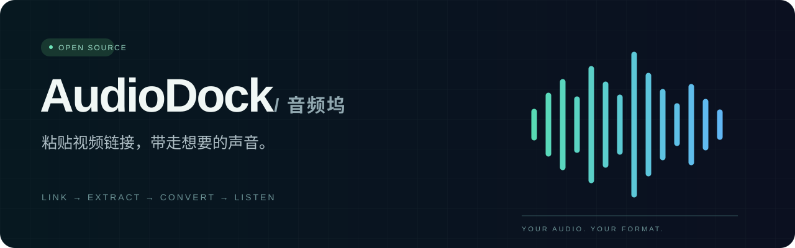
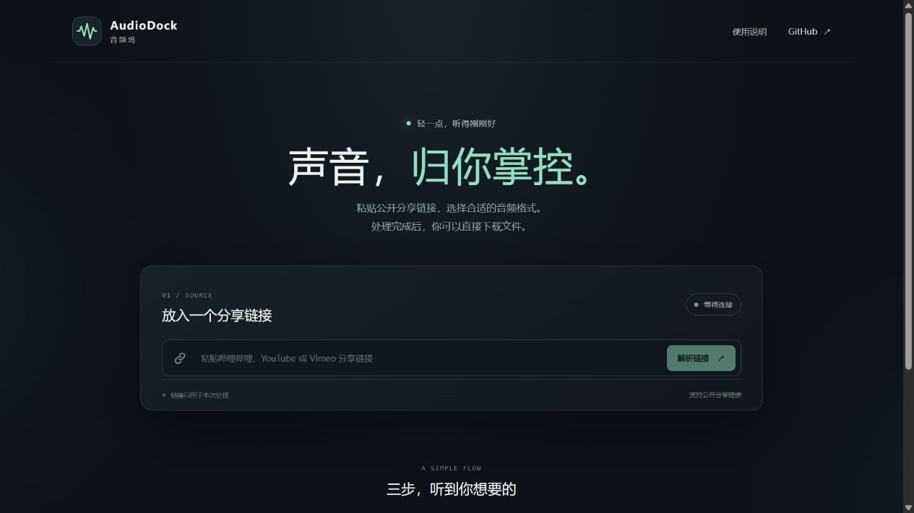
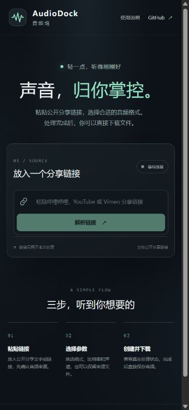

<div align="center">



**把视频链接，变成随身携带的声音。**

[](https://github.com/PWJCSqiushan/audiodock/actions/workflows/ci.yml)
[](LICENSE)
[](#本地运行)

[**打开网页体验 →**](https://pwjcsqiushan.github.io/audiodock/) · [快速开始](#三步带走音频) · [自己部署](docs/DEPLOYMENT.md) · [反馈问题](https://github.com/PWJCSqiushan/audiodock/issues)

</div>

---

AudioDock 是一个开源的视频链接转音频工具。复制分享文字或视频链接，选择格式和音质，等待处理完成后直接下载。适合把有权使用的视频内容整理成通勤、学习或跑步时听的音频。

**部署状态与实测记录见 [验收记录](docs/VALIDATION.md)。** GitHub Pages 承载界面，真实下载与转码依赖独立后端。后端未连接、休眠或上游拒绝访问时，页面会如实说明，不生成模拟的“成功结果”。

## 为什么做 AudioDock

| 少一点折腾 | 多一点掌控 |
| --- | --- |
| 直接粘贴整段分享文字 | 自动提取支持的视频链接，先确认标题和时长 |
| 一次选择输出格式 | MP3、M4A、Opus、FLAC、WAV、原始音轨 |
| 看得见处理过程 | 排队、下载、转码、校验都有实际状态，可以取消 |
| 文件真正属于你 | 下载成普通音频文件，也可以同时保留原始音轨 |
| 自己也能运行 | 源码、本地运行和容器部署配置都在仓库内 |



<details>
<summary>查看手机界面</summary>



</details>

## 三步带走音频

1. 打开 [AudioDock](https://pwjcsqiushan.github.io/audiodock/)，粘贴视频链接或平台的整段分享文字。
2. 解析视频后确认标题，选择音频格式、码率、采样率和声道。
3. 创建任务，等待完整性校验完成，再下载音频。需要源音轨时，在开始前勾选保留选项。

默认是 **MP3 / 320 kbps / 原采样率 / 原声道**。高码率不会补回源音轨已经丢失的声音信息。

## 格式怎么选

| 格式 | 适合什么场景 | 可调参数 |
| --- | --- | --- |
| **MP3** | 常见播放器、运动设备，兼容优先 | 128 / 192 / 256 / 320 kbps |
| **M4A** | AAC 音频，兼顾体积与兼容 | 128 / 192 / 256 kbps |
| **Opus** | 希望用更小体积保存音频 | 64 / 96 / 128 / 160 kbps |
| **FLAC** | 后续编辑或使用无损压缩容器 | 采样率、声道 |
| **WAV** | 未压缩 PCM，方便音频软件读取 | 采样率、声道；文件较大 |
| **原始音轨** | 保留平台提供的音频，不再次编码 | 保持源格式、采样率与声道 |

MP3、AAC 和 Opus 是有损编码。把已经有损的音频转换为 FLAC/WAV **不会提高音质**；想避免再次编码，应选择“原始音轨”。

## 网站与使用边界

首版提供 **哔哩哔哩、YouTube、Vimeo** 的独立入口。支持入口不等于每条视频、每个地区或每次访问都能成功；实际兼容状态见 [验收记录](docs/VALIDATION.md)。

- 处理单条公开视频；合集、播放列表和批量下载不在本版范围。
- 只处理你有权下载和转换的内容，不提供登录凭据上传或付费、DRM、地区限制的绕过功能。
- 网站接口、地区限制或访问风控发生变化时，工具可能需要更新。
- 不要在 Issue 中粘贴 Cookie、访问令牌、完整日志中的签名地址或私人视频。

## 免费演示的限制

公开演示采用 Render Free，适合低频体验。空闲后可能休眠，唤醒大约需要一分钟；界面会显示连接状态。它不是持续在线的文件托管服务。

| 项目 | 默认限制 |
| --- | --- |
| 运行任务 | 1 个，同时最多排队 5 个 |
| 视频时长 | 最长 60 分钟 |
| 原始音轨 | 最大 256 MiB |
| 输出文件 | 最大 750 MiB |
| 访问频率 | 每个访问者每小时最多 3 个已接受任务 |
| 下载链接 | 完成后 30 分钟有效，重启可能提前失效 |

平台本身还有免费运行时间、带宽和临时磁盘限制。资源不足时会拒绝新任务，不自动开通付费资源。长期或大量使用建议自己部署。详见 [Render 免费服务说明](https://render.com/docs/free)。

## 本地运行

需要 Python 3.12+、Node.js 22+，以及能在命令行运行的 FFmpeg / FFprobe。

```bash
git clone https://github.com/PWJCSqiushan/audiodock.git
cd audiodock
python -m venv .venv
```

激活虚拟环境：Windows PowerShell 用 `.venv\Scripts\Activate.ps1`，macOS/Linux 用 `source .venv/bin/activate`。然后启动后端：

```bash
python -m pip install -r backend/requirements.txt
python -m uvicorn app.main:app --app-dir backend --host 127.0.0.1 --port 8787 --no-access-log --no-proxy-headers
```

另开终端启动网页：

```bash
cd web
npm ci
npm run dev
```

访问终端显示的本地地址。默认开发后端为 `http://127.0.0.1:8787`。用容器运行后端也可以：

```bash
docker compose up --build
```

环境变量、API 和安全配置见 [部署说明](docs/DEPLOYMENT.md) 与 [接口契约](CONTRACT.md)。生产页面必须配置实际后端地址，不能使用访客电脑的 localhost。

## 测试

```bash
python -m pip install -r backend/requirements-dev.txt
python -m pytest backend/tests -q
cd web
npm ci
npm test
npm run build
```

自动测试使用合成音频与受控响应，不会每次运行都下载一小时视频。真实站点回归、界面截图和云端检查单独记录，不把 mock 测试写成线上成功。

服务启动与文件响应测试需要本机回环网络：运行 pytest 前设置
`AUDIODOCK_TEST_LOOPBACK=1`（PowerShell：`$env:AUDIODOCK_TEST_LOOPBACK="1"`）。CI 会启用这两项测试。
后端启动后，可运行 `python scripts/smoke_test.py "视频链接" --output artifacts/check.mp3`
完成真实任务、下载哈希与完整解码检查；它会消耗正常任务额度。
脚本会在输出旁保存私有的 `.job.json` 断点，下载请求失败后用同一命令可继续查询原任务。
断点含临时下载令牌，请勿公开或提交；默认 `artifacts/` 已被忽略。
需要单独排查环境代理时可加 `--no-proxy`，它只影响这一次脚本进程。

## 致谢

这个项目始于两段跑步音乐的音轨整理，感谢让这件事变得可实现的开源工作：

- **[yt-dlp](https://github.com/yt-dlp/yt-dlp) 团队与贡献者**：持续维护媒体提取器。
- **[FFmpeg](https://ffmpeg.org/) 团队与贡献者**：提供音频转码、探测和解码校验能力。
- **[BBDown](https://github.com/nilaoda/BBDown) 作者 nilaoda**：其开源工作为最初的 B站下载方案调研提供了参考。原仓库已归档，AudioDock 不依赖其程序。
- FastAPI、React、Vite 及各依赖的作者与维护者。

自有代码采用 [MIT License](LICENSE)，依赖保留各自许可，详情见 [第三方声明](THIRD_PARTY_NOTICES.md)。本项目与上述项目或视频平台没有隶属关系。

---

**English:** AudioDock is an open-source web app for extracting and converting audio from authorized public video links. It combines a React interface, a Python job queue, yt-dlp and FFmpeg. The public demo runs with limited free resources; self-hosting instructions and honest validation results are included.
