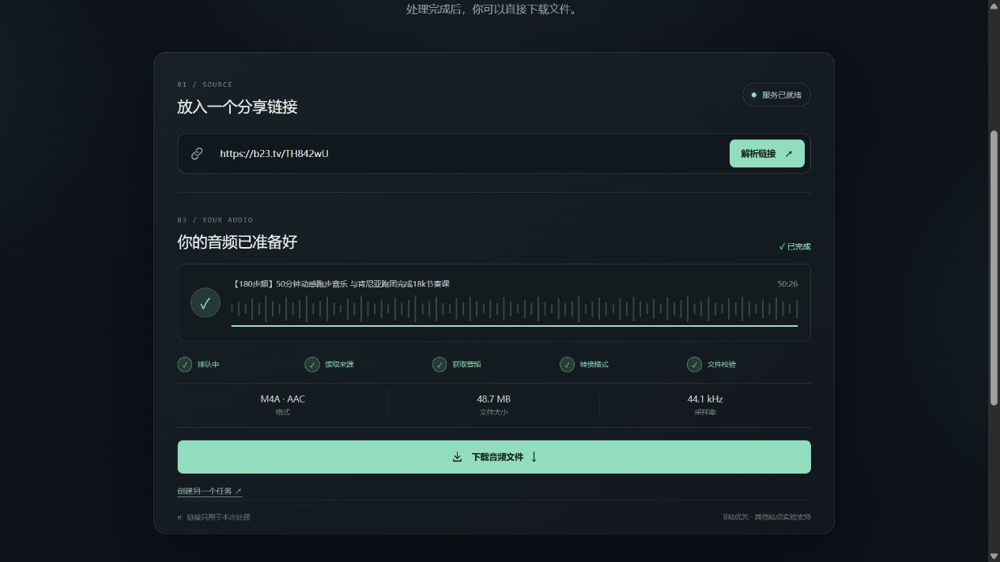

# 验收记录

记录日期：2026-10-27，v0.1.0。测试结果对应当时的代码、站点与网络环境，不能保证未来每条视频都可访问。

- 网页：[GitHub Pages](https://pwjcsqiushan.github.io/audiodock/)
- 后端：[Render API 健康检查](https://audiodock-api.onrender.com/api/health)，Singapore / Free / 单 worker。

| 检查 | 状态 |
| --- | --- |
| 后端自动测试 / 合成音频各格式 | 31/31 通过；合成音频六格式输出及完整解码、断点 Range、队列、取消、令牌、过期、请求体限制、ASGI 2.3 完整应用下载均有覆盖 |
| 前端自动测试与生产构建 | 16/16 通过；锁文件安装、生产构建通过 |
| 桌面 / 手机界面检查 | 浏览器实测，390px 手机视口无横向溢出；截图见 README |
| 本机真实站点端到端 | 未通过：本机代理 DNS 返回 198.18.* Fake-IP，被公网地址防护拒绝；未降低防护 |
| YouTube / Vimeo 公开链接 | 尚未通过：YouTube 样片解析失败，Vimeo 样片要求登录；保留实验性入口，不上传凭据 |
| GitHub Actions / 容器构建 | [CI 全部通过](https://github.com/PWJCSqiushan/audiodock/actions/runs/40449078826)，含 Linux 后端、前端、Docker 构建与容器健康检查 |
| Render 真实下载与转码 | 53 分钟 B站音乐已完整获取、MP3 320k 转码、下载及本机完整解码通过，文件哈希与 API 一致 |
| B站短链接 | 两条用户提供的 b23 链接均已真实解析成功，返回对应视频页 |
| Pages 页面完整下载流程 | 第二条短链接 → 识别 → 原始音轨 → 完成 → 浏览器下载通过；下载字节数、SHA-256、完整解码通过 |

## 真实 MP3 文件证据

测试源：`BV1RVPFzEEKm`，53 分钟跑步音乐。通过 Render API 完成，未把此前个人下载脚本的结果当成开源工具的验收。

| 字段 | 实测 |
| --- | --- |
| 文件字节数 | 127,229,072 |
| 时长 | 3180.69551 秒（源元数据 3181 秒） |
| 编码 | MP3 / 320,000 bps / 44,100 Hz / 2 声道 |
| SHA-256 | `1b0f68479a7dd62292ef2b6b3a5b8679d23654984e021d2a19dae6fbe445b276` |
| 本机校验 | 下载字节数与 API 一致；SHA-256 一致；FFmpeg `-xerror` 完整解码通过 |

媒体、临时下载令牌与私有断点均未提交到仓库。使用 `scripts/smoke_test.py` 可独立复测，正常消耗任务额度。

## 浏览器原始音轨证据

测试源：`https://b23.tv/TH842wU` → `BV1MgGE6aEhV`。在公开 Pages 页面选择“原始文件”，从真实 Render 服务获取 M4A。

| 字段 | 实测 |
| --- | --- |
| 文件字节数 | 51,024,758 |
| 时长 / 编码 | 3026.378707 秒 / AAC / 44,100 Hz / 2 声道 |
| SHA-256 | `b66c8b208bdd9d012f77d94df62615b1809ab4b5b2780784cb146e61a3a8ac10` |
| 完整性 | 与 API 哈希一致；FFmpeg 完整解码通过；与此前独立保存的同一来源音轨逐字节一致 |

浏览器首次点击已保存文件，但自动化的下载事件等待未返回；之后通过浏览器文件下载接口确认保存，再对实际磁盘文件校验。没有把等待事件超时当作服务失败或成功的依据。

## 本轮修复与限制

- 真实大文件下载发现 ASGI 中间件误造断开事件，已修复，并用经过完整应用的 ASGI 2.3 下载回归覆盖。
- B站短链接解析后统一使用对应视频页作为 Referer，避免把短域名错误传给 metadata/playurl 请求。
- Render 免费实例长音频转码可能需要数分钟；空闲休眠后首次连接也需要等待。重启会丢失临时任务与文件。
- 某些站点请求仍会暂时返回上游错误，手动重新解析后可能成功，不保证连续可用。
- Render 的旧版 FFprobe 对原始分段 M4A 的 `bit_rate` 可能报告不可靠数值；界面不展示该字段。文件完整性按字节、哈希与解码验证，原始音轨不据此重新编码。
- YouTube 测试包括 `BaW_jenozKc` 与 `aqz-KE-bpKQ`；Vimeo 为 `76979871`。这些失败不能推广成平台所有视频都不可用，也不算成功支持。

网站提供入口不代表每条视频都能下载；本机结果、mock 结果和云端结果分开记录。
